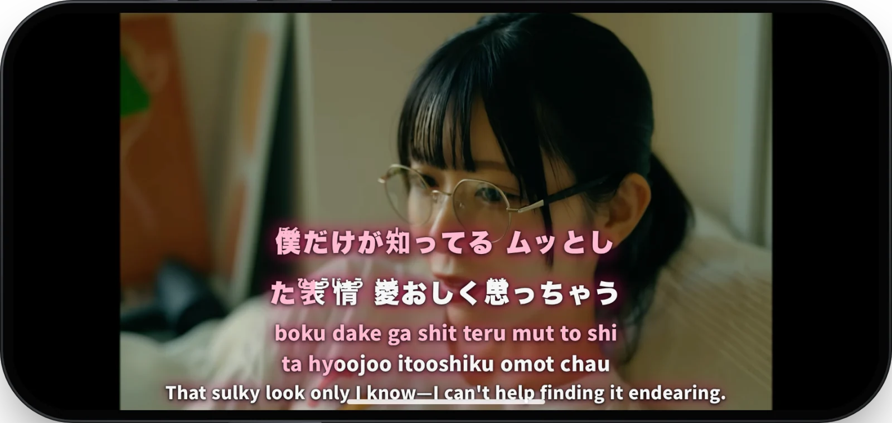

<p align="center">
  <a href="https://synbox.io" target="_blank" rel="noopener noreferrer">
    <picture>
      <source media="(prefers-color-scheme: dark)" srcset="docs/readme/Synbox.svg" />
      
    </picture>
  </a>
</p>

<p align="center">
  <strong>Sing along to Japanese songs on YouTube.</strong>
  <br />
  Karaoke lyrics timed to every syllable, with furigana, romaji and English or Chinese translations.
</p>

<p align="center">
  <a href="./LICENSE"></a>
</p>

<p align="center">
  <a href="https://synbox.io" target="_blank" rel="noopener noreferrer"><strong>Open Synbox</strong></a>
  ·
  <a href="https://github.com/lifuhh/synbox-transcribe-whisper" target="_blank" rel="noopener noreferrer">Backend Repository</a>
  ·
  <a href="https://github.com/lifuhh/synbox/issues" target="_blank" rel="noopener noreferrer">Report a Bug</a>
</p>

<p align="center">
  
</p>

Most Japanese music videos on YouTube have no lyrics you can follow, let alone readings or a translation. Synbox lays them over the video. Pick a song from the library or paste any YouTube link: Synbox works out the lyrics from the recording, times them syllable by syllable, adds readings and a translation, and plays them in step with the video. It runs in the browser and installs on a phone as an app.

This repository is the web app. The lyrics pipeline that listens to each song lives in [synbox-transcribe-whisper](https://github.com/lifuhh/synbox-transcribe-whisper).

## Karaoke Timed to Every Syllable

<p align="center">
  
</p>

- **Syllable by syllable.** The highlight follows the singer through each line, as on a karaoke machine.
- **Readings for every kanji.** Furigana sit above the kanji and romaji below the line. The Japanese, the romaji and the translation each switch on and off.
- **English or Chinese.** The whole song is translated at once, so each line reads in context.
- **Lyrics panel and reader.** The full lyrics scroll beside the video. The reader shows them as a page, with its own playback controls.

## Any Song on YouTube

<p align="center">
  
</p>

If a song is not in the library yet, paste its link. Synbox downloads the audio, isolates the vocals, transcribes them, checks the result against published lyrics, and times every syllable. A new song takes a few minutes. Each step shows its progress, and you can keep browsing while it runs. Generating needs a Google sign-in and is free, within a daily limit. The result is saved, so the next person to open the song gets the karaoke straight away.

## Made for Phones

<p align="center">
  
</p>

<p align="center">
  
</p>

- **Installs as an app.** Add it to the Home Screen on iPhone, or install it from Chrome on Android. It opens full screen, with a tab bar.
- **Turn it sideways.** In landscape the video fills the screen with the lyrics on top. Lock Landscape keeps it that way.
- **Lock Screen.** Hides the controls and ignores touches until you unlock, so a stray tap never stops the song.
- **Double-tap to skip** 10 seconds back or forward, as in a video app.
- **Read offline.** Songs you open, bookmark or generate are saved for reading without a connection.

## Make the Lyrics Yours

<p align="center">
  
</p>

Set the size, pick one of seven colour presets or mix your own, and choose a backdrop that keeps the lyrics readable on any video. Two Lines shows the next line early so you can read ahead. A style can apply to every song or to just one, and My Styles keeps the ones you make. Signed in, your settings follow you to every device.

## Find Something to Sing

<p align="center">
  
</p>

- **Search the way you would describe it.** "Sad song by a female singer" finds songs by mood and voice. A title or an artist finds that song, in Japanese or romaji.
- **Recommendations and YouTube Charts.** The home page has songs ready to sing and Japan's current Top 100.
- **More Like This.** Every song suggests others by the same artist, then by mood, voice and theme.
- **Your library.** Bookmarks, playlists and recently played songs, synced across your devices when you sign in.

## How It Works

| Part | Runs on | Does |
| --- | --- | --- |
| Web app (this repository) | Netlify | The player, lyrics stage, library and installed app. React, TypeScript, Tailwind CSS and shadcn/ui, built with Vite+ and Bun |
| [Backend](https://github.com/lifuhh/synbox-transcribe-whisper) | Google Cloud Run | The lyrics pipeline, karaoke timing and library search. Python and Flask |
| Accounts | Cloudflare Worker and D1 | Google sign-in with Better Auth, daily limits, synced library and settings |
| Storage | Appwrite | Songs and their lyrics |

Videos play through YouTube's own embedded player.

## Running Locally

```sh
bun install
cp .env.example .env   # Appwrite ids, the backend URL and a YouTube Data API key
bun run dev
```

`bun run typecheck`, `bun run test` and `bun run lint` are the checks every change passes.

## Disclaimer

Synbox is a personal project, made to help me understand and enjoy Japanese music videos. It is non-commercial, has no monetization, and is meant for personal, educational use. Songs, lyrics and videos belong to their rights holders. I will promptly remove any content a copyright holder asks me to remove: [open an issue](https://github.com/lifuhh/synbox/issues) or message me on [LinkedIn](https://www.linkedin.com/in/lifuhh).

## Contacts

Feel free to reach out for feedback, issues, or contributions:

**Lifu**: [LinkedIn](https://www.linkedin.com/in/lifuhh) **GitHub Issues**: [Report issues](https://github.com/lifuhh/synbox/issues)

## License

Synbox is a non-commercial passion and learning project. It has no monetization and never will.

The code is licensed under the [PolyForm Noncommercial License 1.0.0](./LICENSE). You may read, run, fork and modify it for any non-commercial purpose, such as personal study, hobby projects or research. Commercial use is not permitted.
