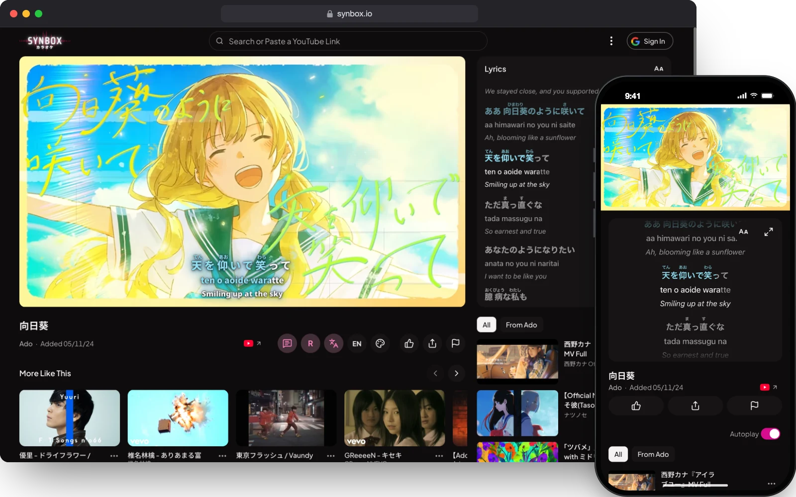
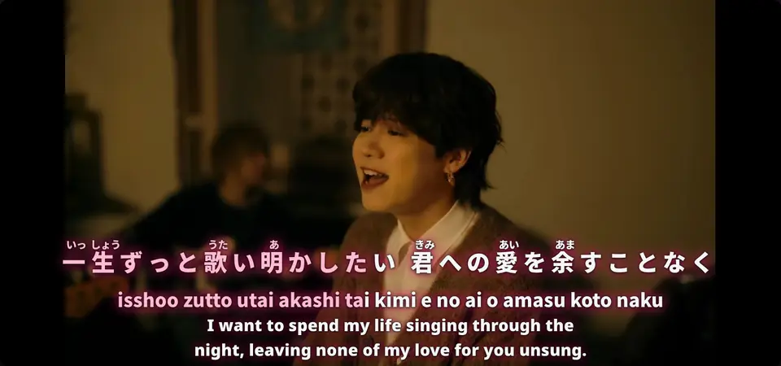
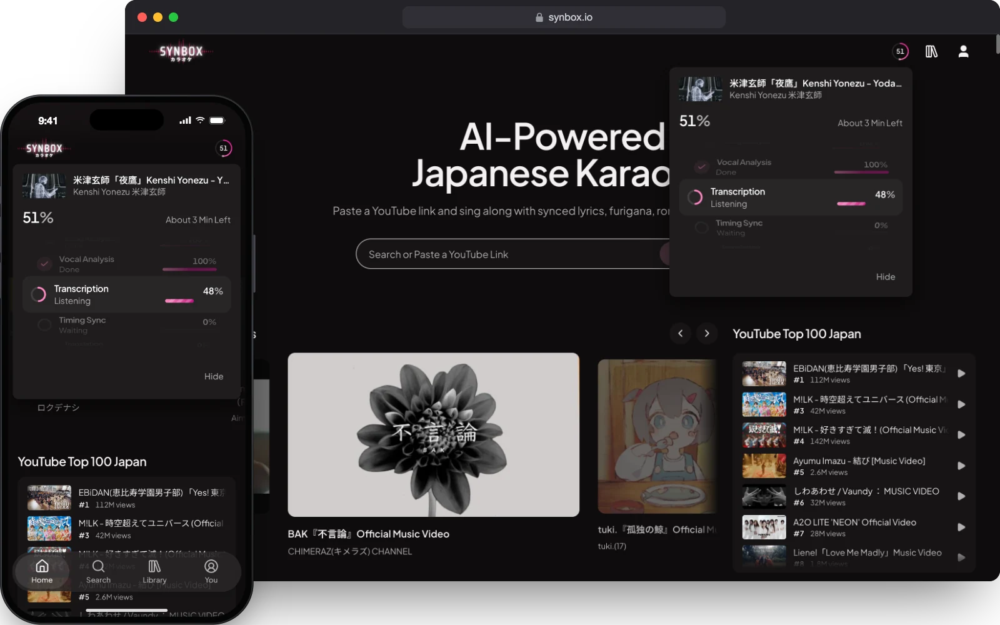
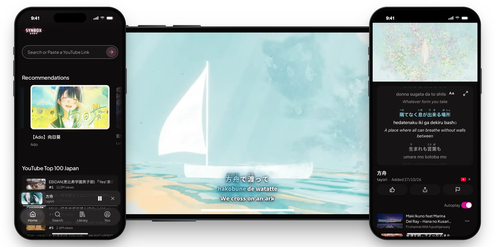
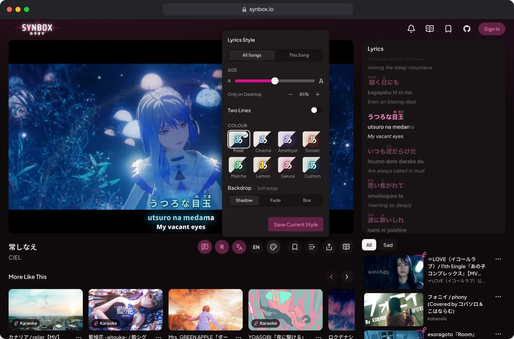
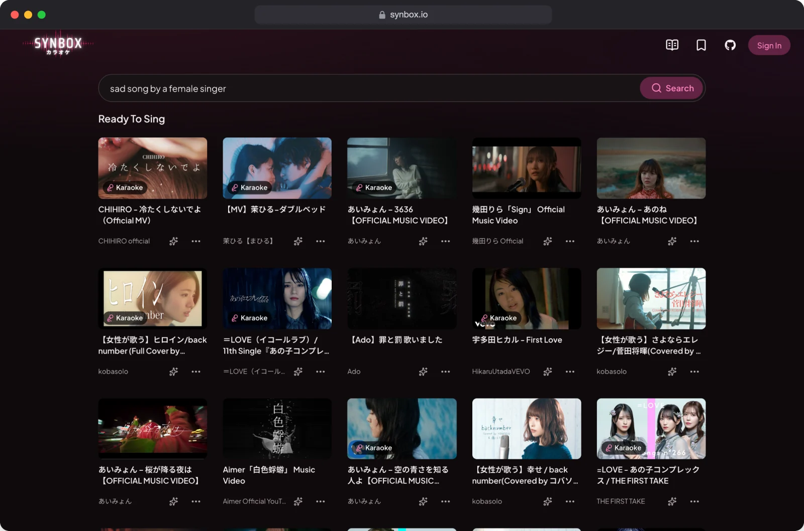

<p align="center">
  <a href="https://synbox.io">
    <picture>
      <source media="(prefers-color-scheme: dark)" srcset="docs/readme/Synbox.svg" />
      
    </picture>
  </a>
</p>

<p align="center">
  <strong>Sing along to Japanese songs on YouTube.</strong>
  <br />
  Lyrics timed to every syllable, with furigana, romaji and an English or Chinese translation.
</p>

<p align="center">
  <a href="https://synbox.io"><strong>Open Synbox</strong></a>
  ·
  <a href="https://github.com/lifuhh/synbox-public/issues">Report a Bug</a>
</p>

<p align="center">
  
</p>

Pick a song or paste a YouTube link. The lyrics play over the video and fill as they are sung, with readings and a translation. Synbox runs in the browser and installs on a phone as an app.

This repository is the web app and its auth Worker. The service that makes the lyrics is private.

## Karaoke

<p align="center">
  
</p>

- **Timed to every syllable**, like a karaoke machine.
- **Furigana** over the kanji, **romaji** under the line. Each layer turns on and off.
- **English or Chinese.** The whole song is translated at once, so lines read in context.
- **Lyrics panel and reader.** Scroll the full lyrics beside the video, or read them as a page.

## Any Song on YouTube

<p align="center">
  
</p>

Paste a link to a song that isn't in the library. Synbox transcribes it and aligns it to its lyrics, word by word: published lyrics when they match, speech recognition when they don't. Progress shows step by step while you browse. The song is saved for everyone. One new song a day is free; signing in gives you more.

## Made for Phones

<p align="center">
  
</p>

- **Installs as an app** on iPhone and Android, with a tab bar.
- **Upright:** the video above the lyrics, which follow the song.
- **Full Screen** turns the player on its side: the video fills the screen with the lyrics on top. Lock Landscape keeps it there.
- **Lock Screen** ignores stray taps until you unlock.
- **Double-tap** to skip 10 seconds.
- **Offline reading** for songs you open, bookmark or generate.

## Your Style

<p align="center">
  
</p>

<p align="center">
  
</p>

Size, seven colour presets or your own. Karaoke Style sets the lyrics in two rows, like a karaoke machine: one on the left, the next on the right, the translation above. Styles apply to every song or just one, and follow you across devices when you sign in.

## Find Something to Sing

<p align="center">
  
</p>

- **Search by description:** "sad song by a female singer" matches mood and voice, read by [TypeSafe's Jev](https://docs.typesafe.ai/api). Titles and artists work in Japanese or romaji.
- **Recommendations and Japan's YouTube Top 100** on the home page.
- **More Like This** under every song: same artist first, then mood, voice and theme.
- **Library:** bookmarks, playlists and history, merged into your account when you sign in.

## Built With

The same groups as the [About page](https://synbox.io/about), with a little more detail.

- **Code:** TypeScript and React on Vite, Tailwind CSS. Python and Flask for the lyrics service. SQL on Cloudflare D1. Better Auth for Google sign-in.
- **AI:** LLMs, speech recognition and NLP make each song's lyrics, readings and translations; evals keep them accurate. TypeSafe's Jev understands searches and tags each song's mood and voice.
- **Platforms:** OpenAI, Anthropic Claude, ElevenLabs and TypeSafe for AI. Google Cloud runs the lyrics service, Cloudflare the accounts, Netlify the site, Appwrite the song files. YouTube's embedded player and Data API for video. Sentry for errors.

Security lives in code: a strict Content-Security-Policy, HSTS, rate limits, per-account quotas, and a build that fails instead of shipping source maps.

## Run It Locally

Requires [Bun](https://bun.sh).

```sh
bun install
cp .env.example .env    # each variable is explained in the file
bunx vp dev
```

Songs and lyrics come from the private backend, so a local copy needs its own services to show them.

## Disclaimer

Synbox is a personal, non-commercial project for enjoying Japanese music videos. Songs, lyrics and videos belong to their rights holders. To have something removed, use **Contact Me** at the bottom of [synbox.io/about](https://synbox.io/about).

## License

[PolyForm Noncommercial 1.0.0](./LICENSE): free to read, run, fork and modify for non-commercial use.
