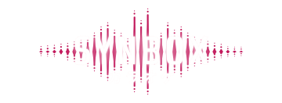
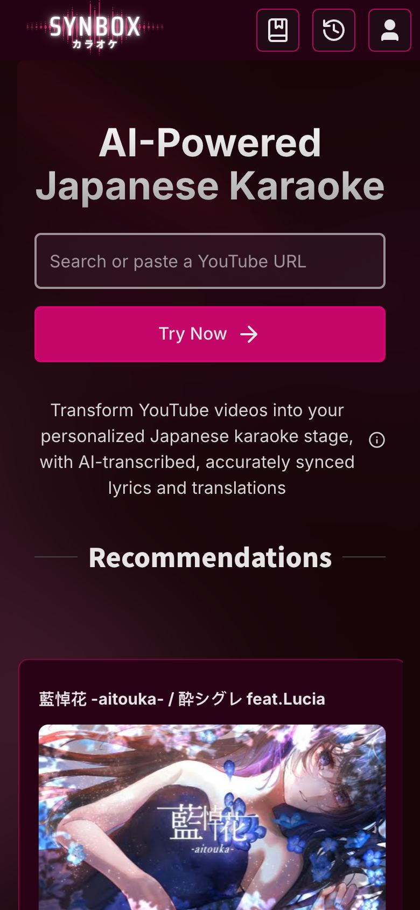
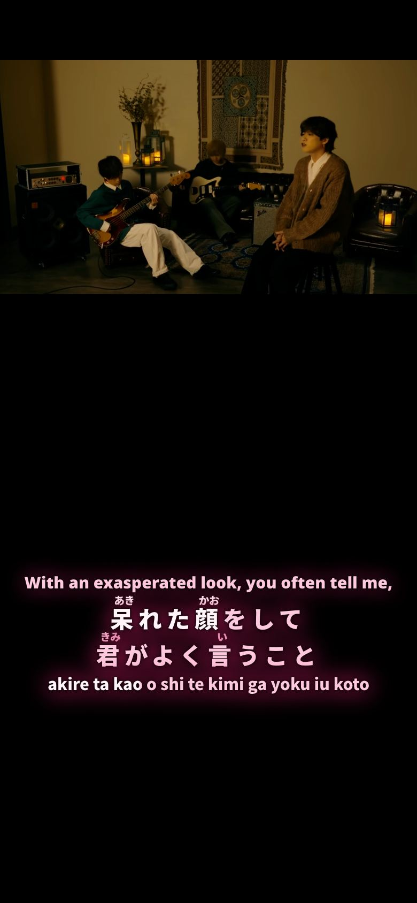

<p align="center">
  <a href="https://synbox.io"></a>
</p>

<p align="center">
  Japanese karaoke for any YouTube video: synced lyrics with furigana, romaji and translations.<br />
  <a href="https://synbox.io"><strong>synbox.io</strong></a>
</p>

<p align="center">
  
</p>

<p align="center">
  
  &nbsp;
  
</p>

This is the frontend of Synbox: the web app, its installable PWA, and the auth Worker. The lyrics generation service is a separate, private repository.

## What it does

- **Sing along to any Japanese song on YouTube.** Paste a link or search; lyrics fill mora by mora in time with the singer, with furigana over the kanji, romaji, and an English or Chinese translation.
- **Make lyrics for songs that have none.** Anyone can ask for a new song from a YouTube link; generation streams its progress and keeps running if the phone sleeps.
- **Read it your way.** Karaoke or plain lines, one or two lines at a time, adjustable size and style per song, playback speed, and a full-screen player built for a phone on its side.
- **Install it.** The same build runs as a website and as an installed app on iOS, Android and desktop.
- **Keep a library.** Playlists and history on the device, merged into an account at sign-in; likes for accounts.

## How it is built

| Part | What runs it |
| --- | --- |
| Web app | React 19, TypeScript, Vite+ (Vite with Rolldown, Oxlint, Oxfmt), Tailwind CSS 4, Jotai, Motion |
| Hosting | Netlify: the static app, two functions (YouTube Data API proxy, cached song list) and an Edge Function for link previews |
| Accounts and app data | A Cloudflare Worker at `api.synbox.io` (Hono, Better Auth with Google sign-in, D1), proxied as first-party `/api` |
| Lyrics and songs | A private generation service and a read-only lookup service; song files in Appwrite |
| Errors | Sentry, with source maps uploaded at build and never deployed |

Security basics are in the code, not just in docs: a strict Content-Security-Policy (no eval, no inline scripts), HSTS, rate limits on the Netlify functions, per-account quotas in the Worker, and builds that fail rather than ship a source map.

## How it is developed

Since October 2026 the app has been built mostly by AI coding agents (Claude Code) working in parallel sessions, with one person setting direction and reviewing. The repository is set up so an agent's "done" has to come with evidence:

- **[`AGENTS.md`](AGENTS.md)** is the contract every agent reads: what must never be committed, how to work on phones and desktop, and how a change ships.
- **One task, one worktree, one PR.** `harness/wt.ts` gives each task its own worktree and dev server, so sessions never touch each other's work. Finished PRs collect in `staging`.
- **`harness/bench/cli.ts check` gates every PR**: typecheck, lint, tests and formatting, bundle-size budgets, and layout audits of every route in three views (desktop Chromium, and iPhone WebKit upright and on its side, with safe areas), plus iPhone Safari and a 320px screen. The audits measure what users hit: undersized or covered tap targets, content under the notch, sideways scrolling, clipped text, controls with no accessible name, and controls that act on press instead of release. A hook refuses a PR without a passing verdict for the exact tree.
- **One release path.** `harness/release.ts` is the only way to production: it re-checks `staging`, smoke-tests a local production build, a deploy preview and then the live site, and stops at the first failure.
- **Every change has a written why.** Each PR carries a change-log entry (problem, cause, change, lesson, judgment calls). The log is kept private; this public copy is exported without it.

### This public copy

This repository is an export of the private one, rebuilt with full history by a script that removes what must stay private and refuses to publish until its checks pass: a secret scan of every commit (gitleaks), no song lyrics in any version of any file, and no private notes, personal data or internal links in files or commit messages.

## Run it locally

Requires [Bun](https://bun.sh).

```sh
bun install
cp .env.example .env    # the names and what each one is for are in the file
bunx vp dev
```

Lyrics and generation come from the private backend, so a local copy needs its own services to show songs.

## License

[PolyForm Noncommercial 1.0.0](LICENSE): free to read, run and modify for noncommercial use.
